<div align="center">

# Quire

**A quiet EPUB reader for Windows, Mac, iPhone and Android.**
Your books stay on your device. No account, no server, no tracking.

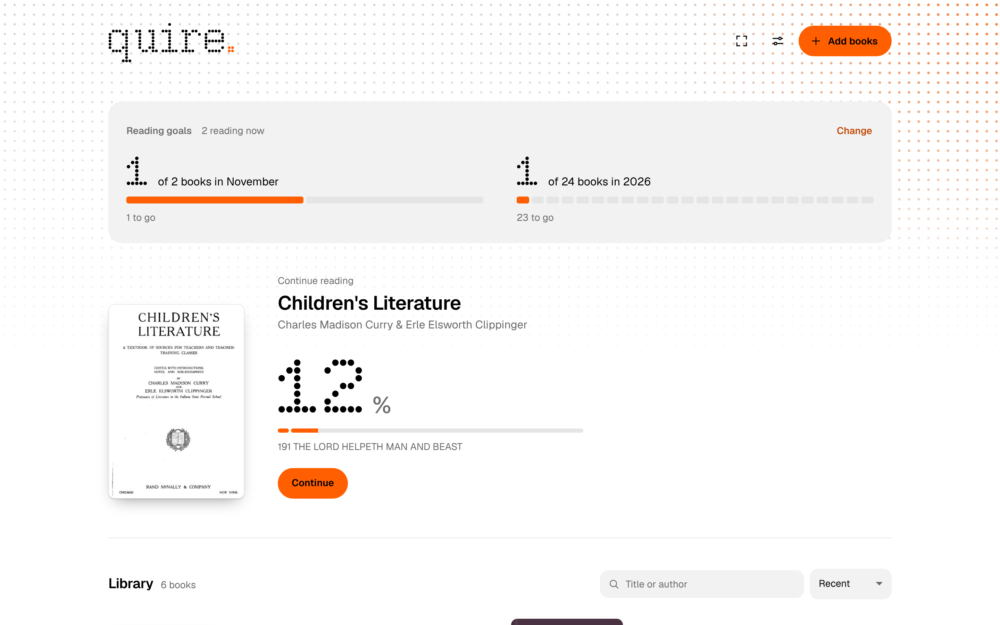

</div>

## What it does

**Reading that feels like paper.** Pages curl from the corner like a real book, with the print showing faintly through the back. You can also choose a plain slide, or no animation at all.

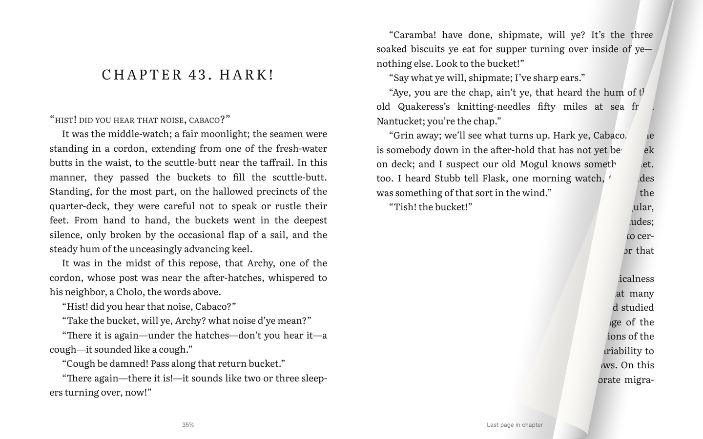

**Five page themes.** Paper, Linen, Slate, Ember and Night, each with its own type and colours. The app itself follows your system's light or dark mode, in orange and white or orange and black.

<p>
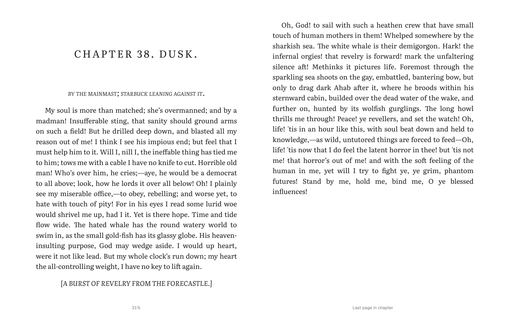
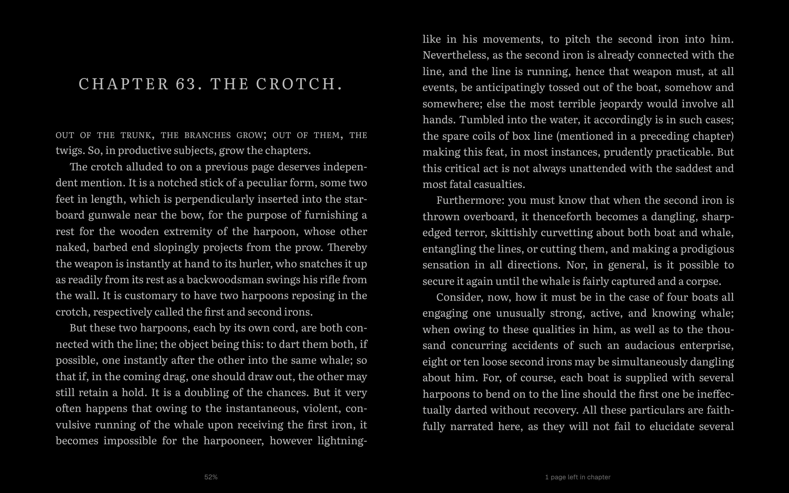
</p>

**A dictionary that works offline.** Hold or double-click a word for its meaning, pronunciation and similar words. The same menu adds a note, copies, searches the book, or highlights in one of five colours. It covers nearly 150,000 English words from Princeton WordNet and the CMU Pronouncing Dictionary, with nothing sent anywhere.

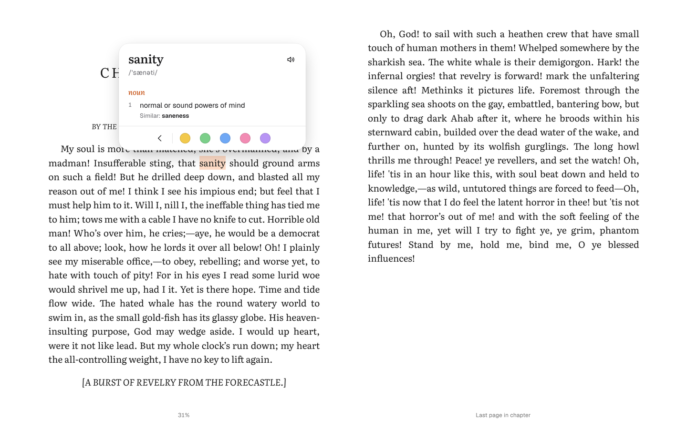

**A chapter bar that knows the book.** The bar at the bottom follows the table of contents, with one segment per chapter and wider gaps between parts. Hover or drag to see the page, chapter and part before you jump.

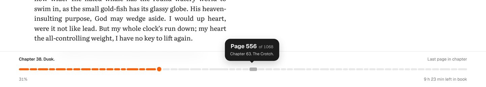

**Reading goals.** Set how many books you want to finish each month and each year. The library shows how far you are, and how many books you are reading now.

**Make it yours.** Settings, Advanced, has three styles: the clean Quire look, Typewriter (the app and your books set in Courier Prime, as if typed) and Dot matrix (titles and the logo in dots). You can also change the app typeface, the accent colour (orange, red, blue, green or graphite), the pattern behind the home screen (dots, grid, lines or diagonal), interface text size, square or round corners, what the bottom of the page shows, which way the left edge turns, and how fast pages turn. Reset puts it all back.

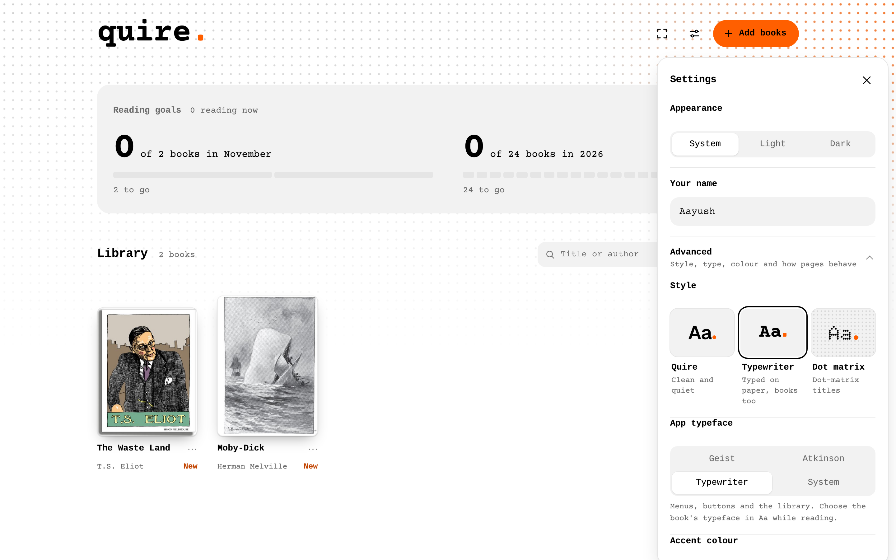

**Room to read.** Focus mode leaves only the text: no running heads, no page info, no pointer. On a computer, full window hides the title bar too; press Esc, or move to the top edge and click the X, to come back.

### On your phone

<p>
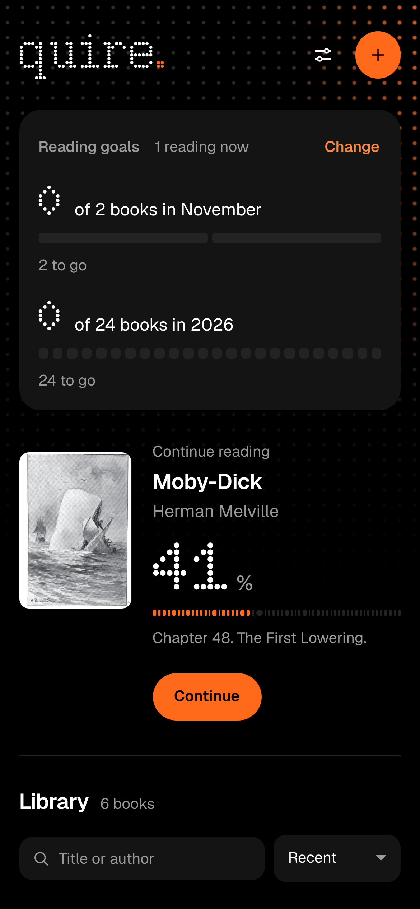
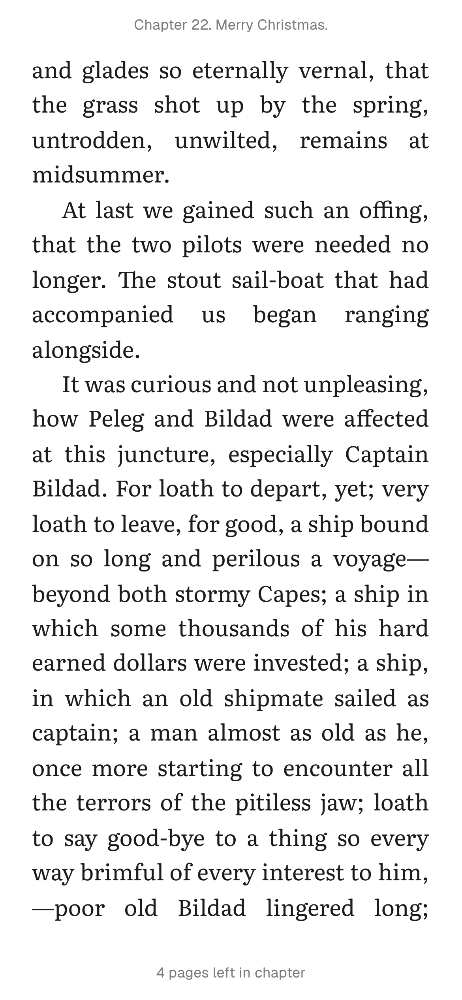
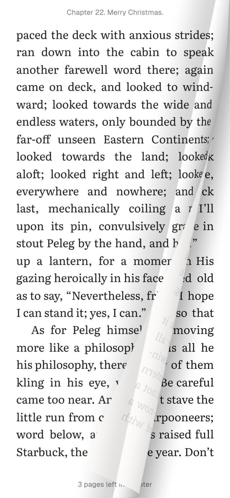
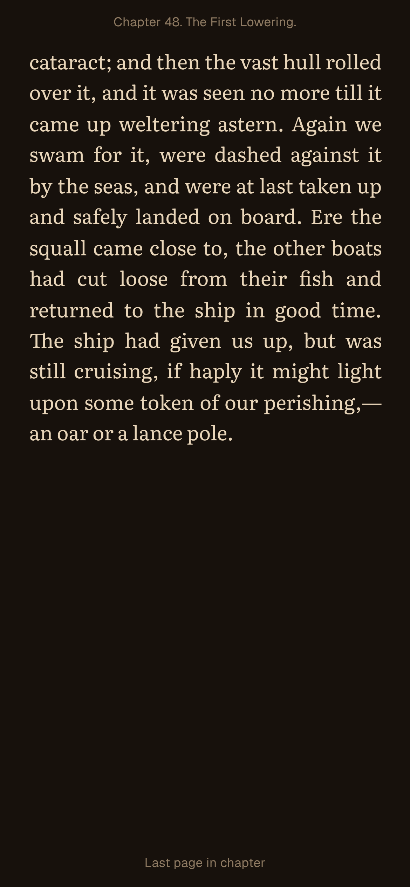
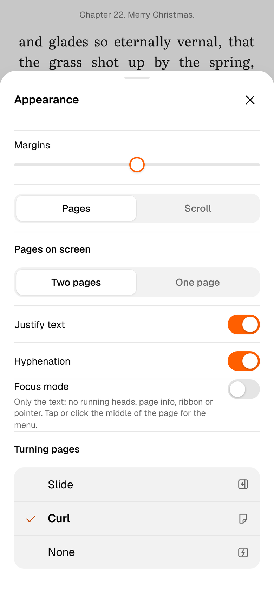
</p>

Open a book straight from Files, Downloads or the share sheet, and it lands in your library.

## Everything else

- Fonts: the book's own, or Literata, Source Serif 4, Geist, Atkinson Hyperlegible Next and Typewriter, with size, line spacing and margins
- One or two pages side by side, or continuous scrolling
- Bookmarks with a ribbon, notes, highlights, and export of all your highlights
- Search inside a book, and a side panel with the contents, your bookmarks and your highlights
- Respects your system's reduced-motion setting, with keyboard control throughout

## Install

Builds for all four platforms come from GitHub Actions in this repository: **Actions, Build apps, Run workflow**, then download from **Artifacts**. Step-by-step instructions for each platform, including sideloading on iPhone with a free Apple ID, are in [INSTALL.md](INSTALL.md).

## Build it yourself

```
npm install
npm run desktop      # run the desktop app
npx cap sync         # copy www/ into the iOS and Android projects after editing
```

The workflow in `.github/workflows/build.yml` builds a Windows installer, a Mac disk image (Apple silicon and Intel), an Android APK and an unsigned iPhone app.

## How it is made

| Part | What it uses |
| --- | --- |
| Reader | One web codebase in `www/`, with the [foliate-js](https://github.com/johnfactotum/foliate-js) EPUB engine |
| Windows and Mac | Electron, with a locked-down `app://` scheme and context isolation |
| iPhone and Android | Capacitor 8 |
| Page curl | WebGL, drawn from a picture of the page. On phones the picture comes from a small native plugin (PixelCopy on Android, WKWebView snapshots on iPhone) |
| Storage | IndexedDB on each device |

## Privacy

Quire has no backend. Books, highlights, notes, progress and goals live only on the device you read on, and the dictionary is built in. Nothing is uploaded, and there are no API keys in this project. The flip side is that devices do not sync with each other.

## Status

- The apps build on all four platforms. Real-device testing has only just started.
- Pages are counted from the layout on screen, so the count changes with the font size, the same as in most e-readers.
- English dictionary only, without word origins.
- No DRM: books bought from Kindle or Kobo will not open.

## Credits

- [foliate-js](https://github.com/johnfactotum/foliate-js) by John Factotum, MIT licence (`www/vendor/foliate-js/LICENSE`)
- Princeton WordNet 3.0 and the CMU Pronouncing Dictionary (`www/dict/LICENSE-*.txt`)
- Literata, Source Serif 4, Atkinson Hyperlegible Next, Geist, Doto and Courier Prime under the SIL Open Font License (`www/fonts/OFL-*.txt`)
- Screenshots use public-domain and openly licensed sample books.
